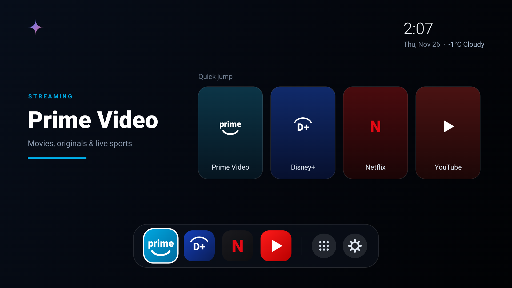

# Glass Dock

A lightweight, ad-free, dark-glass custom launcher for Amazon Fire TV Sticks—built with a direct Fire TV Settings Hub, automatic app categorization, and a rotating 1080p landscape screensaver.



## Documentation & Install Guide

Full screenshots, DNS blocklists, bloatware cleanup, and step-by-step ADB installation instructions live on the docs site:

👉 **[glassdock.dev](https://glassdock.dev)** *(or view the raw guide in [`docs/index.md`](docs/index.md))*

## Quick Links

- **Download APK:** [Latest GitHub Release](https://github.com/leolion3/GlassDock/releases/latest)
- **Install Guide:** [glassdock.dev](https://glassdock.dev)
- **More Projects:** [leonardhaddad.com](https://leonardhaddad.com)

## Build Locally

```bash
./gradlew assembleRelease
adb install -r app/build/outputs/apk/release/app-release.apk
```
