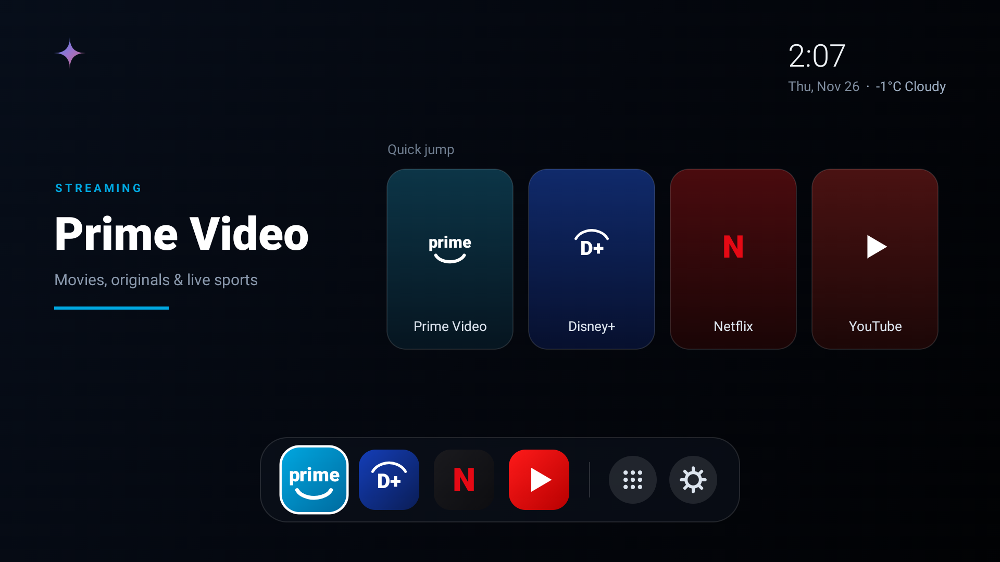
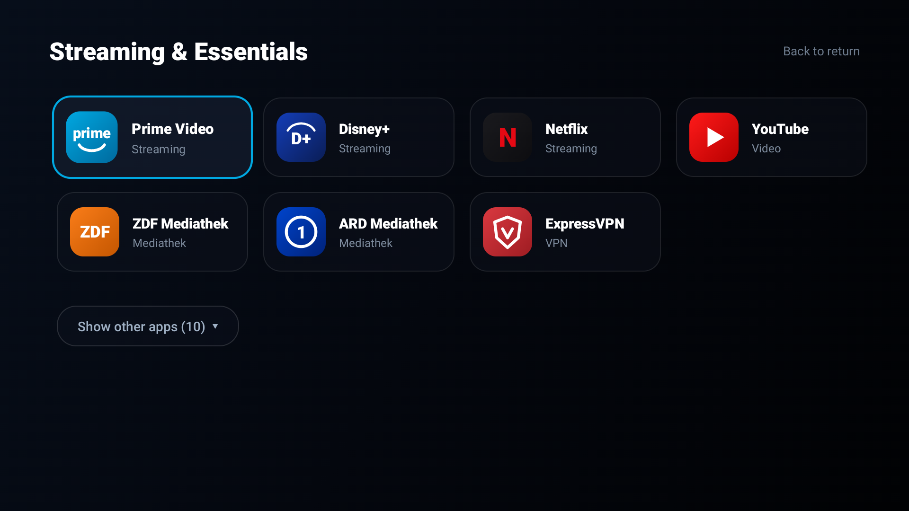
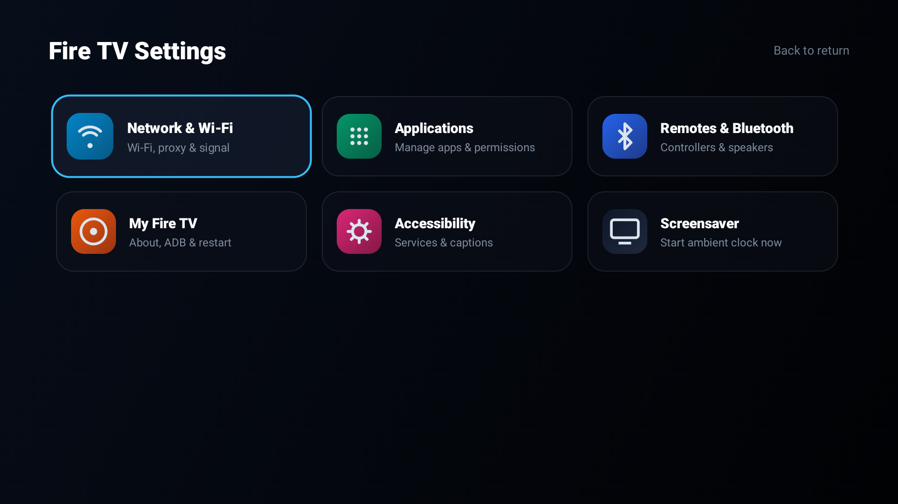
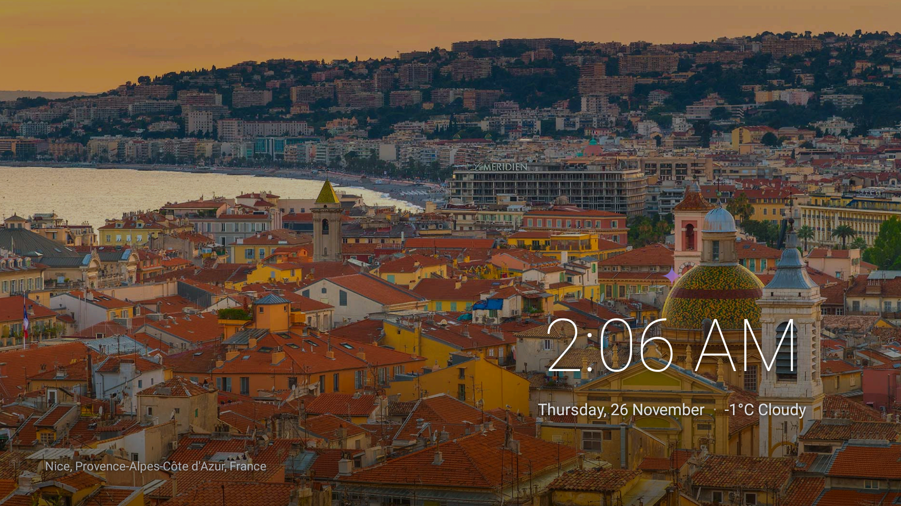

# Glass Dock for Fire TV

A lightweight, ad-free, dark-glass custom launcher for Amazon Fire TV Sticks—complete with a
built-in Settings Hub, automatic app categorization, and a rotating 1080p landscape screensaver powered by Bing.

!!! info "Transparency Note: AI was used to assist with writing both the launcher code and this documentation. However, every command, build, and deployment step in this guide has been personally executed, tested, and verified on real hardware by me - a real human ;]"

## Demo

<div class="demo-grid" markdown>

<div class="demo-card" markdown>

Home Screen & Floating Glass Dock
</div>

<div class="demo-card" markdown>

All Apps Library with Custom Vector Icons
</div>

<div class="demo-card" markdown>

Direct Fire TV Settings Hub
</div>

<div class="demo-card" markdown>

Rotating 1080p Landscape Screensaver
</div>

</div>

---

## Step 1: Enable Developer Mode on Fire TV

Before your computer can talk to your Fire TV Stick, you need to unlock the hidden Developer Options
menu:

1. On your Fire TV, go to **Settings** (gear icon) → **My Fire TV** → **About**.
2. Highlight **Fire TV Stick** (the very first item) and press the **Select (center)** button on
   your remote **7 times** quickly.
3. A toast message will say *"No need, you are already a developer."*
4. Press **Back** once. You will now see **Developer Options** in the menu.
5. Open **Developer Options** and turn **ADB Debugging** to **ON**.
6. Go back to **About** → **Network** and write down your Fire TV's **IP Address** (e.g.,
   `192.168.1.50`).

---

## Step 2: Install ADB & Connect from Your Computer

You only need a computer on the same Wi-Fi network as your Fire TV Stick.

=== "macOS"

```bash
brew install android-platform-tools
```

=== "Windows (PowerShell)"

```powershell
winget install Google.PlatformTools
```

=== "Linux (Ubuntu/Debian)"

```bash
sudo apt update && sudo apt install adb
```

Connect to your Fire TV Stick (replace `192.168.1.50` with your Stick's IP - You can get this in the "Network" section of your settings):

```bash
adb connect 192.168.1.50:5555
```

!!! info "Allow USB Debugging Prompt"
Look at your TV screen—a popup will ask to **Allow USB debugging**. Check **"Always allow from this
computer"** and click **OK**. Run `adb devices` to confirm your Stick is listed as `device`.

---

## Step 3: Block Amazon Auto-Updates & Telemetry

Amazon frequently pushes firmware updates that patch custom launchers. Add the following domains to
your **Pi-hole**, **AdGuard Home**, **UniFi**, or router's DNS blocklist to freeze your firmware and
block telemetry/ads:

```txt
softwareupdates.amazon.com
updates.amazon.com
prod.ota-cloudfront.net
d1s31zyz7dcc2d.cloudfront.net
amzdigital-a.akamaihd.net
amzdigitaldownloads.edgesuite.net
device-metrics-us.amazon.com
device-metrics-us-2.amazon.com
device-metrics-eu.amazon.com
device-messaging-na.amazon.com
device-messaging-eu.amazon.com
fls-na.amazon.com
fls-eu.amazon.com
unagi-na.amazon.com
unagi-eu.amazon.com
arcus-uswest.amazon.com
mads.amazon.com
mads-eu.amazon.com
aax-us-east.amazon-adsystem.com
aax-eu.amazon-adsystem.com
c.amazon-adsystem.com
s.amazon-adsystem.com
adtago.s3.amazonaws.com
aan.amazon.com
avs-alexa-na.amazon.com
avs-alexa-eu.amazon.com
alexa.amazon.com
alexa.amazon.de
api.amazonalexa.com
bob-dispatch-prod-na.amazon.com
bob-dispatch-prod-eu.amazon.com
```

---

## Step 4: Disable Built-in Amazon Bloatware (Optional)

You can safely disable unused Amazon bloatware to free up RAM and speed up the Stick.

!!! warning "Important Note for ARD / ZDF Mediathek Users: Do **not** blindly disable Amazon's system WebView or media/account services. Disabling those underlying services will cause **ARD Mediathek** and **ZDF Mediathek** to fail to load or crash on startup. Stick strictly to the safe list below."

Copy and paste these commands into your terminal:

```bash
# Disable Amazon Freevee, Music, Photos, Games, Shop & News
adb shell pm disable-user --user 0 com.amazon.imdb.tv.android.app
adb shell pm disable-user --user 0 com.amazon.bueller.music
adb shell pm disable-user --user 0 com.amazon.bueller.photos
adb shell pm disable-user --user 0 com.amazon.ags.app
adb shell pm disable-user --user 0 com.amazon.amazonshop
adb shell pm disable-user --user 0 com.amazon.hedwig

# Disable telemetry & ad services
adb shell pm disable-user --user 0 com.amazon.device.metrics
adb shell pm disable-user --user 0 com.amazon.advertisingidsettings
```

!!! info "Missing Packages"
If any command prints `Unknown package`, that app simply isn't installed on your specific Fire TV model—you can safely ignore it and move on.

!!! warning "Protected System Packages"
Newer Fire TV hardware and Fire OS builds lock down certain core Amazon services (including the stock launcher) at the system level. 

If a command returns a `SecurityException` or refuses to disable a protected package, that's expected on unrooted devices.

You can safely skip those—Glass Dock's Accessibility Service handles overriding the Home button without needing to disable the stock launcher.

---

## Step 5: Install Glass Dock & Set as Default Launcher

1. Download the latest `app-release.apk` from
   the [GitHub Releases](https://github.com/leolion3/GlassDock/releases) page.
2. Install the APK onto your Fire TV Stick:
   ```bash
   adb install -r app-release.apk
   ```
3. Grant Glass Dock permission to stay awake, draw over other apps, and intercept the **Home**
   button:
   ```bash
   adb shell cmd package set-home-activity com.glassdock.launcher/.HomeActivity
   adb shell appops set com.glassdock.launcher SYSTEM_ALERT_WINDOW allow
   adb shell dumpsys deviceidle whitelist +com.glassdock.launcher
   adb shell am set-standby-bucket com.glassdock.launcher active
   adb shell settings put secure accessibility_enabled 1
   adb shell settings put secure enabled_accessibility_services com.glassdock.launcher/com.glassdock.launcher.HomeRedirectService
   ```
4. Press the **Home** button on your Fire TV remote—Glass Dock will now take over.

!!! tip "Remote Shortcuts"

* **Menu button** (three lines): Opens the Glass Dock **Settings Hub**.
* **Play/Pause button** (on Home screen): Launches the **Ambient Landscape Screensaver** immediately
  (it also starts automatically after 3 minutes of inactivity).

---

## Step 6: Final Cleanup & Troubleshooting

### Turn Off ADB Debugging

Once everything works, go to **Settings Hub → My Fire TV → Developer Options** and switch **ADB
Debugging** back to **OFF** for security. All of your settings and the launcher override will
persist.

### Home Button Isn't Redirecting?

Verify that Fire OS bound the Accessibility Service:

```bash
adb shell "dumpsys accessibility | grep -i glassdock"
```

You should see `com.glassdock.launcher/com.glassdock.launcher.HomeRedirectService` under **Bound
services**. If it isn't bound, reset it with:

```bash
adb shell settings put secure enabled_accessibility_services ""
adb shell settings put secure enabled_accessibility_services com.glassdock.launcher/com.glassdock.launcher.HomeRedirectService
adb shell settings put secure accessibility_enabled 1
```

### How to Revert to the Stock Amazon Launcher

If you ever want to go back to the default Fire TV interface:

```bash
adb shell settings put secure enabled_accessibility_services ""
adb uninstall com.glassdock.launcher
```

---

Looking for more tools and experiments? Check out my other [projects](https://leonardhaddad.com).
